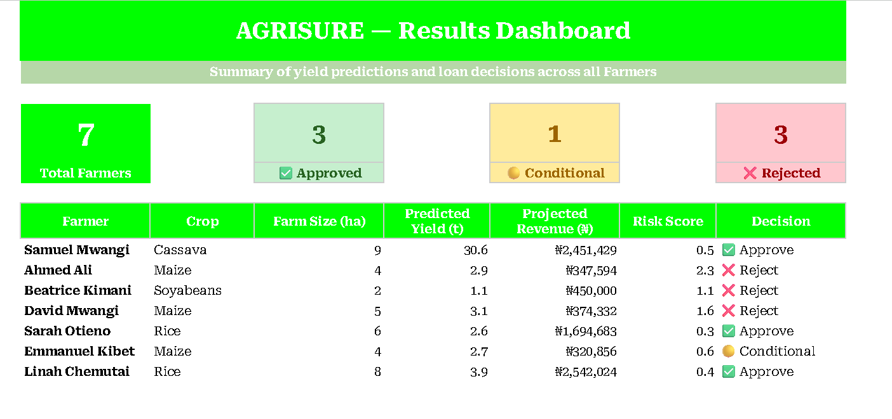

# AGRISURE: Crop Yield Prediction and Loan Risk Model

**Tools:** Excel (nested logical functions)

## Overview
An Excel model built for a hackathon that predicts crop yield for farmers and scores the risk of lending to them. It classifies each loan request as Approve, Conditional or Reject. All farmer data is a sample dataset.

## How the model works
1. **Input efficiency:** actual input spend divided by the expected input cost for the farm size.
2. **Predicted yield:** farm size × base yield × input efficiency.
3. **Projected revenue:** predicted yield × market price per tonne.
4. **Risk score:** loan requested ÷ projected revenue.
5. **Decision:** risk below 0.50 is Approve, 0.50 to 0.75 is Conditional, above 0.75 is Reject.

## Results
Seven sample farmers across four crops (maize, rice, cassava, soyabeans):
- 3 approved, 1 conditional, 3 rejected.
- The three rejected farmers each requested a loan larger than their projected revenue, giving risk scores above 1.
- No maize farmer was approved: low input efficiency and a lower market price kept projected revenue below the loan.

## Dashboard

## Files
- The Excel workbook: data, formulas and results dashboard
- `AGRISURE_PROJECT.pdf`: printable copy of all four sheets
- `dashboard.png`: dashboard screenshot
